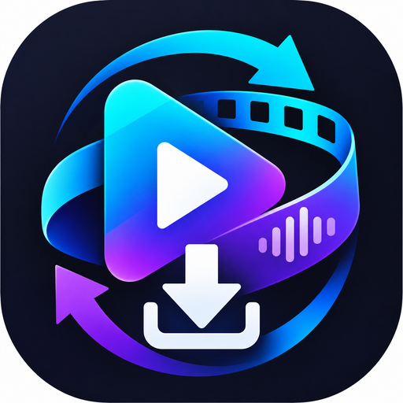

<p align="center"></p>

# MediaForge

Android app to download, extract and convert media **on the device**: no servers, no accounts, no ads.
Built with Kotlin, Jetpack Compose, [yt-dlp](https://github.com/yt-dlp/yt-dlp) and [FFmpeg](https://ffmpeg.org).

**Status:** 1.0.0. Download the APK from [Releases](https://github.com/franbenaglia/mediaForge/releases/latest).

<!-- Screenshots: docs/images/screenshots (T12.6) -->

## Features

- **Download:** paste or share a link and see the real formats the site offers, with sizes. Download video in MP4 up to the chosen quality, or audio only in MP3, M4A, Opus, OGG, WAV or FLAC. Subtitles can be embedded, and public playlists download as one job per video.
- **Convert offline:** change the format of local files, remuxing without quality loss when possible. You can also trim (fast or frame-accurate), save a frame as JPG or PNG, convert up to 50 files at once and compress video.
- **Queue:** downloads and conversions run in the background, with real progress, cancel, retries on network errors and a "Wi‑Fi only" option.
- **Files and history:** saved to the gallery or to a folder you choose, never overwriting a file. The history is searchable.
- **Always up to date:** yt-dlp updates itself, at most once a week, after verifying its signature and checksum.
- **Private:** English and Spanish, light and dark theme, TalkBack and large text. Nothing leaves the phone except requests to the sites you choose and to GitHub for engine updates.

Tested with YouTube, Dailymotion and TikTok. Other sites supported by yt-dlp may work.

## Install

1. Download `app-arm64-v8a-release.apk` from the [latest release](https://github.com/franbenaglia/mediaForge/releases/latest). It's the right one for most phones; use `x86_64` for Chromebooks and x86 devices.
2. Open it on the phone. Android asks you to allow installing apps from your browser or file manager.
3. The first launch unpacks the engine (about 240 MB) and takes a few seconds.

Requirements: Android 8.0 or later, about 400 MB of free space.

To check that an APK is genuine, compare it with `SHA256SUMS` and the certificate fingerprint published in the release (see [docs/RELEASE.md](docs/RELEASE.md)).

## Legal

MediaForge is intended for content you own, content in the public domain, or content that the platform and rights holders allow you to download. It does not bypass DRM, paywalls, logins or other access controls, and it doesn't remove watermarks. You are responsible for how you use it.

## Build

Requirements: JDK 17 and the Android SDK (platform 37).

```bash
./scripts/verify.sh      # build, unit tests, lint and ktlint
./gradlew assembleDebug  # debug APK in app/build/outputs/apk/debug/
```

The full guide is in [docs/DEVELOPMENT.md](docs/DEVELOPMENT.md): environment, tests on a phone, releases, and how to update yt-dlp and FFmpeg.

## Documentation

- [docs/DEVELOPMENT.md](docs/DEVELOPMENT.md): how to build, test, release and keep developing
- [docs/ARCHITECTURE.md](docs/ARCHITECTURE.md): modules and data flow (in Spanish)
- [docs/DECISIONS.md](docs/DECISIONS.md): architecture decision records (in Spanish)
- [docs/SECURITY.md](docs/SECURITY.md): security review (in Spanish)
- [docs/LICENSES.md](docs/LICENSES.md): third-party components and license obligations (in Spanish)
- [CHANGELOG.md](CHANGELOG.md): version history

## License

MediaForge is free software under the [GPL-3.0](LICENSE).

It bundles, through [youtubedl-android](https://github.com/yausername/youtubedl-android) (GPL-3.0):
- yt-dlp (Unlicense);
- Python (PSF);
- QuickJS (MIT);
- FFmpeg built with GPL components, plus about 140 libraries.

The app includes their notices under **Settings → Open source licenses**. Each release publishes the corresponding source of the GPL, LGPL and MPL components (`mediaforge-<version>-gpl-sources.tar.gz`).
